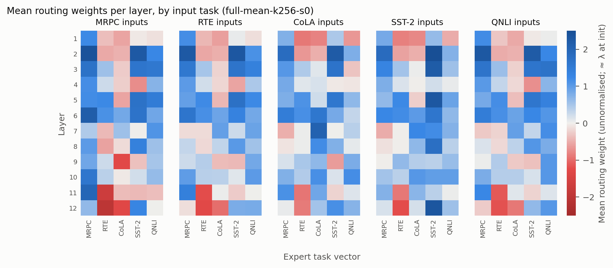

This report presents the results of the first complete run of the pipeline (`notebooks/colab_run_executed_v1.ipynb`). The raw numbers are in `results/` and the full table is in [`results/summary.md`](../../results/summary.md). How to rerun everything is described in the [setup guide](../guide/README.md).

# 1. Summary

1. **Few-shot router training works.** With 256 labelled examples per task, WEMoE + FSFT reaches an average score of **69.9** (std 0.1 over 3 seeds). Task Arithmetic reaches 57.4 and the five single-task experts 78.2.
2. **Plain merging is close to guessing.** Task Arithmetic is only slightly better than predicting the most frequent label:
   - It predicts one class on MRPC and RTE.
   - It recovers **18%** of the gap between a constant guess and the experts.
   - WEMoE + FSFT recovers **59%**.
   - The usual "normalized score" (merged / expert) gives 70.6% and 87.8% instead, because a constant guess already scores 56% on that scale.
3. **RTE is not solved by full-MLP WEMoE.** It stays below the majority class.
   - The routers give the RTE task vector a weight of about **0** even for RTE inputs.
   - Upscaling only `intermediate.dense` gives RTE a large weight and reaches 59.0.
   - Both MoE scopes end up at almost the same average.
4. **The few-shot budget matters.** k = 16 and k = 64 are unstable across seeds (CoLA MCC std 14–18). k = 256 is stable.
5. **Routing is partly input-dependent.** Inputs from different tasks share most of their routing pattern: the mean routing matrices have an average correlation of 0.82. Even so, about 58% of the routing variance comes from the task of the input. A layer-wise, input-independent ablation is prepared (§6) to measure how much this matters.

# 2. Setup

## 2.1 Models and tasks

| | |
|---|---|
| Backbone | `bert-base-uncased` (109.5M parameters) |
| Tasks | MRPC, RTE, CoLA, SST-2, QNLI (GLUE, binary) |
| Task score | MRPC: mean of accuracy and F1; CoLA: Matthews correlation (MCC); others: accuracy |
| Experts | one full fine-tune per task; lr 2e-5, batch 32, 3 epochs, warmup 10%, weight decay 0.01, max length 128, fp16; best epoch chosen on dev |
| Merging | non-MLP weights: Task Arithmetic with λ = 0.3; MLP weights: WEMoE, `W(x) = W0 + Σe we(x) · τe`, one router per layer, unnormalised weights initialised at λ |
| FSFT | routers only (7.1M trainable parameters); cross-entropy on k labelled examples per task; AdamW lr 1e-4, batch 16 per task, 500 steps; best step chosen on dev every 50 steps |
| Hardware | Colab, one Tesla T4 (15 GB); torch 2.11, transformers 5.20, datasets 4.8 |

## 2.2 Data protocol

Each task's official GLUE train split is divided once, with a fixed seed, into three parts:

| Split | Size per task | Used for |
|---|---|---|
| `fewshot_pool` | 256 | FSFT examples. The experts never see them |
| `dev` | 10% of train, at most 1000 | every model choice: expert epoch, Task Arithmetic λ, FSFT best step |
| `expert_train` | the rest (e.g. 1985 for RTE) | expert fine-tuning |

The official GLUE validation split is used only for the numbers reported here. Nothing was selected on it.

## 2.3 Baselines

- **Majority class:** always predicts the most frequent validation label. This is the score of a model that has collapsed to a constant prediction.
- **Simple Averaging:** Task Arithmetic with λ = 1/5.
- **Task Arithmetic (TA):** λ chosen on dev from {0.1, …, 1.0}. The best value is λ = 0.3.
- **WEMoE init:** WEMoE before router training. The router weights start at N(0, 0.01), as in the reference code, so this is close to TA but not identical, and it depends slightly on the seed.

# 3. Main results

Official GLUE validation splits, scores ×100. WEMoE rows are mean ± std over seeds 0, 1, 2.

| Model | MRPC (acc/F1) | RTE | CoLA (MCC) | SST-2 | QNLI | Avg | Normalized | Gain over majority |
|---|---:|---:|---:|---:|---:|---:|---:|---:|
| Single-task experts | 82.1/88.1 | 63.2 | 59.1 | 92.2 | 91.2 | 78.2 | 100.0 | 100.0 |
| Majority class | 68.4/81.2 | 52.7 | 0.0 | 50.9 | 50.5 | 45.8 | 56.4 | 0.0 |
| Simple Averaging (λ = 1/5) | 68.4/81.2 | 46.9 | 23.3 | 55.4 | 65.9 | 53.3 | 66.8 | 6.5 |
| Task Arithmetic (λ = 0.3) | 68.6/81.3 | 47.3 | 16.9 | 69.8 | 77.9 | 57.4 | 70.6 | 18.3 |
| WEMoE init (full MLP) | 68.5±0.1/81.3±0.1 | 47.1±0.2 | 19.3±2.0 | 70.2±1.1 | 77.7±0.2 | 57.8±0.6 | 71.3±1.0 | 18.7 |
| **WEMoE + FSFT (full MLP, k = 256)** | 76.3±4.5/83.9±2.8 | 52.0±4.4 | 42.6±0.9 | 88.0±0.5 | 86.7±0.7 | **69.9±0.1** | **87.8±0.5** | **59.1** |
| WEMoE + FSFT (intermediate, k = 256) | 66.5±0.7/76.6±1.0 | 59.0±0.9 | 41.7±0.9 | 86.7±0.2 | 86.5±0.2 | 69.1±0.1 | 87.4±0.1 | 54.8 |

**Normalized** is the task score divided by the expert's score, averaged over tasks. **Gain over majority** is (score − majority) / (expert − majority), averaged over tasks: 0 is a constant guess and 100 is the expert. The second measure is the honest one for these tasks, because a constant guess already scores 75 on MRPC and about 50 on the accuracy tasks.

*Figure pending: run `python scripts/plot_results.py` once all result files are downloaded (only part of the seeds is available locally).*

How to read the figure:
- The black ticks are the experts and the dashed ticks are the majority class.
- Task Arithmetic sits on the majority tick for MRPC and below it for RTE.
- WEMoE + FSFT clears the majority on every task except RTE (full MLP) and MRPC (intermediate).

Gain over majority per task (×100, from the seed means):

| Model | MRPC | RTE | CoLA | SST-2 | QNLI |
|---|---:|---:|---:|---:|---:|
| Task Arithmetic | 1 | −52 | 29 | 46 | 67 |
| WEMoE + FSFT, full MLP, k = 256 | 51 | −7 | 72 | 90 | 89 |
| WEMoE + FSFT, intermediate, k = 256 | −32 | 60 | 71 | 87 | 88 |

# 4. Few-shot budget

*Figure pending: run `python scripts/plot_results.py` once all result files are downloaded (only part of the seeds is available locally).*

| k (examples per task) | Avg | Normalized | Gain over majority | Best step (of 500) |
|---:|---:|---:|---:|---|
| 16 | 60.8±2.7 | 75.6±4.6 | 25.5 | 50, 150 (seeds 0, 2) |
| 64 | 64.6±3.7 | 79.5±6.3 | 46.7 | 100, 250, 100 |
| 256 | 69.9±0.1 | 87.8±0.5 | 59.1 | 250 (seed 0) |

- **Small k overfits early and varies a lot between seeds.**
  - With k = 16, the best step comes at 50–150, and CoLA MCC ranges from 18 to 44 across seeds.
  - With k = 64, CoLA ranges from 9 to 41.
  - At k = 256, every task has a std of 0.9 or less, except MRPC and RTE, which are small and close to their majority class.
- **Gain grows faster than the average score.** From k = 16 to k = 64 the average moves 3.8 points but the gain over majority almost doubles. Part of the k = 16 average is MRPC and RTE sitting at their constant-guess level.

# 5. Which layers to upscale: full MLP vs. intermediate only

| | Full MLP | Intermediate only |
|---|---:|---:|
| Upscaled modules per layer | `intermediate.dense` + `output.dense` | `intermediate.dense` |
| Stored parameters | 400.0M (73.1% of 5 models) | 258.4M (47.2%) |
| Avg / gain over majority | 69.9 / 59.1 | 69.1 / 54.8 |
| RTE / MRPC acc | 52.0 / 76.3 | 59.0 / 66.5 |
| FSFT time per run (T4) | about 16 min | about 8.5 min |
| Best step (of 500) | 250 (seed 0) | 500, 400, 400 |

- The two scopes reach almost the same average. The intermediate-only model is 35% smaller and trains twice as fast.
- The difference is in which tasks win. Full MLP solves MRPC but not RTE; intermediate-only does the opposite.
- The intermediate-only runs reach their best step at the end of training (400–500 of 500), so they may improve with more steps.

# 6. Routing analysis



The figure averages the routing weights of seed 0 (full MLP, k = 256) over the validation examples of each task. Each panel is one input task, rows are layers and columns are the expert task vectors. Blue adds the task vector and red subtracts it.

1. **The weights leave the Task Arithmetic regime.**
   - Weights range from −3.0 to 4.4. The sum per layer reaches 5.8, against 1.5 at init (5 × λ).
   - FSFT therefore does more than re-weight the experts: it extrapolates along some task vectors and subtracts others.
2. **Most of the pattern is shared across input tasks.**
   - The mean routing matrices of different input tasks have an average correlation of 0.82 (minimum 0.65). For example, every input type turns up MRPC in layers 2–6 and SST-2 in layers 2–3 and 5–6.
   - The input task still explains about 58% of the routing variance; the rest varies between examples of the same task.
   - Seed 1 gives the same picture (0.84 and 60%).
3. **Each task tends to up-weight its own expert, except RTE.**

   Mean weight of a task's own expert, averaged over layers:

   | Task | On its own inputs | On other tasks' inputs |
   |---|---:|---:|
   | MRPC | 1.37 | 0.77 |
   | SST-2 | 1.37 | 0.67 |
   | QNLI | 0.94 | 0.56 |
   | CoLA | 0.61 | −0.02 |
   | RTE | 0.01 | −0.01 |

   The RTE task vector is subtracted in layers 11–12 for every input type, including RTE (−1.2). This matches RTE staying below the majority class.
4. **Intermediate-only routing does use the RTE expert.** On RTE inputs it gives the RTE expert 0.96 on average and 2.04 in layer 12. This is the scope where RTE reaches 59.0.

## Pending: input-independent ablation

Finding 2 raises a question: how much of the gain comes from *input-dependent* routing, and how much from simply learning better per-layer merge coefficients? To answer it, the notebook now runs `router_hidden_layers=0`:
- each layer has one learned coefficient per expert, the same for every input;
- it uses the same FSFT data, with lr 1e-3, since only 60 numbers are trained;
- the runs are named `full-mean-h0-k256-s{0,1,2}`.

Its results will be added here.

# 7. Efficiency and cost

## 7.1 Storage

| Deployment | Checkpoints | Stored parameters | Size (fp32) | vs. 5 models |
|---|---:|---:|---:|---:|
| 5 single-task models | 5 | 547.4M | 2.04 GiB | 100.0% |
| Task Arithmetic | 1 | 109.5M | 0.41 GiB | 20.0% |
| WEMoE (full MLP) | 1 | 400.0M | 1.49 GiB | 73.1% |
| WEMoE (intermediate only) | 1 | 258.4M | 0.96 GiB | 47.2% |

- WEMoE keeps one task vector per expert for every upscaled module, so it saves only 27% (full MLP) or 53% (intermediate) of the storage of five models. 283M of the 400M parameters are MLP task vectors.
- The task id is known at inference time, because each task keeps its own classification head. The five experts would therefore be both more accurate and only 37% larger than full-MLP WEMoE. The case for WEMoE has to rest on the intermediate-only variant, or on settings where the task of an input is unknown.

## 7.2 Training cost on one T4

| Step | Time |
|---|---|
| Five experts | about 45 min in total (RTE 0.7 min, QNLI about 30 min) |
| Baselines (single-task, SA, 10 TA λ values) | about 2 min |
| WEMoE + FSFT, full MLP | 14–16 min per run, the same for every k (500 steps) |
| WEMoE + FSFT, intermediate | about 8.5 min per run |
| All 12 FSFT runs | about 2.8 h |

Inference latency was measured (`results/efficiency.json`) and will be added once the full result files are downloaded. WEMoE builds one merged weight per input, so its batched latency is expected to be well above that of a single BERT.

# 8. Other observations

- **Task Arithmetic collapses on the small pair tasks.** On MRPC it predicts "paraphrase" almost always (acc 68.6 vs. majority 68.4). On RTE it predicts `not_entailment` for every example (47.3 = 131/277). Simple Averaging behaves the same way.
- **SST-2 dev and validation disagree for merged models.** At λ = 0.3, TA scores 83.7 on dev but 69.8 on validation. The dev split comes from SST-2 train, which contains many short phrases; validation contains full sentences. Choosing λ on dev is still correct, but dev scores for SST-2 overstate merged-model quality.
- **WEMoE init is close to TA, not equal to it.** The small random router weights move CoLA MCC by up to ±2 points between seeds (19.3±2.0 vs. TA 16.9), because the merged model sits near its decision boundary on CoLA. Results are deterministic for a given seed.
- **The RTE expert is weak.** It reaches 63.2, the low end of the usual BERT-base range. Its dev accuracy was still rising at epoch 3, and holding out the few-shot pool and dev leaves only 1985 training pairs.

# 9. Limitations

- **"Few-shot" is not strictly few-shot.**
  - FSFT trains on k examples per task, but the best step is chosen on a dev split of up to 1000 labelled examples per task.
  - With k = 16 that is up to 60 times more labels for model selection than for training (the "true few-shot" problem; Perez et al., 2021).
  - A strict variant would cap dev at k examples.
- **One seed for the experts.** Seeds vary only the router initialisation and the few-shot sample, not the experts or the data split.
- **Small validation sets.** RTE (277) and MRPC (408) have standard errors of about 3 and 2 points, which is larger than several of the differences in §5.
- **Comparison with the paper is only qualitative** (§10).

# 10. Comparison with the WEMoE paper

Tang et al. (ICML 2024) evaluate WEMoE on CLIP-ViT models and eight image classification tasks. There, WEMoE nearly closes the gap to the individual fine-tuned models. Here, a clear gap remains: 59% of the gain over majority, and 69.9 vs. 78.2 average score. The two settings differ in ways that plausibly explain this:

| | Paper | This project |
|---|---|---|
| Models and tasks | CLIP-ViT, 8 image classification datasets | BERT-base, 5 GLUE tasks (single sentence and sentence pair) |
| Router training | test-time adaptation: entropy minimisation on the unlabelled test set | FSFT: cross-entropy on 256 labelled examples per task |
| Data for routers | thousands of test inputs per task (transductive) | 1,280 training examples in total |
| Experts | fine-tuned from a strong shared image–text encoder | fine-tuned BERT-base, with weak experts on the two smallest tasks |

The overall shape of the results matches the paper: static merging loses most of the experts' gain, and input-dependent MLP routing recovers a large part of it at the cost of storing the task vectors.

# 11. Next steps

1. Run the input-independent ablation (§6) and add it to §3 and §6.
2. Add the latency table (§7.2) from `results/efficiency.json`.
3. Optionally, a strict few-shot variant with dev capped at k, and more FSFT steps for the intermediate-only model.
4. Analyse routing per example: does within-task variation follow sentence length, label or errors? Use `predictions_validation.jsonl`.
5. Build the demo.

# Reproducing

```bash
python scripts/summarize_results.py --results-dir results   # tables -> results/summary.md
python scripts/plot_results.py --results-dir results        # figures -> docs/report/figures/
```

Training runs on Colab; see the [setup guide](../guide/README.md).
